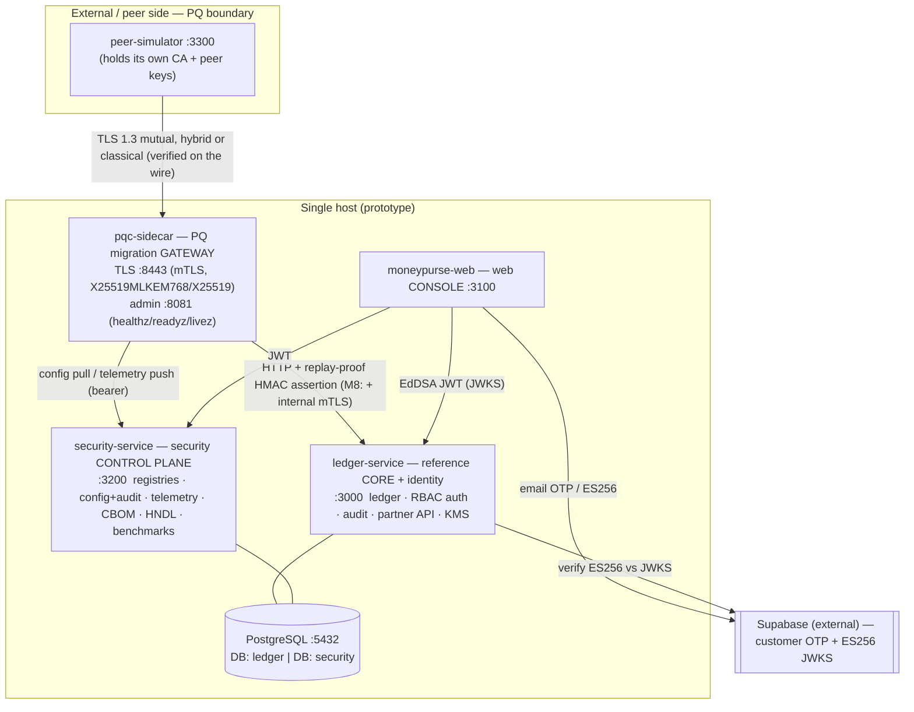

# Architecture & Source-Code Roadmap

A map of the whole system and every directory, so the codebase can be navigated quickly. Pair this
with `docs/audits/04_ARCHITECTURAL_GAPS.md` (gaps + target architecture) and `README.md` (overview).

## 1. System at a glance

**The one PQ-protected link is peer→sidecar (key establishment only).** Everything else is classical.
The product is a *cryptographic-migration platform* (sidecar + control plane) demonstrated against a
*reference core*; the two are kept distinct (a real deployment would swap in a real bank core).

## 2. Component responsibilities

| Component | Owns | Does **not** own |
|---|---|---|
| **pqc-sidecar** (gateway) | TLS termination, hybrid/classical negotiation, wire group verification, peer identity (cert fingerprint), per-peer policy, signed assertion, telemetry, benchmarks, dev PKI, internal mTLS | business logic, persistence, user authz |
| **ledger-service** (core + IdP) | accounts, double-entry postings, idempotency, reversals, reconciliation, identity/JWT/JWKS + rotation, RBAC, banking audit chain, partner API, KMS-encrypted PII | TLS negotiation, crypto policy, settlement/clearing |
| **security-service** (control plane) | peer/provider/profile registries, versioned config + config audit, telemetry store, CBOM, HNDL simulator, benchmark evidence, status registry | TLS termination, banking data |
| **moneypurse-web** (console) | presentation, session handling, SIM/LIVE/PLANNED labelling | any authoritative enforcement (APIs enforce) |

## 3. Service internals (hexagonal)

The three backend services share a **ports-and-adapters** shape: pure `domain/`, interfaces in
`ports/`, concrete `adapters/` (Postgres + in-memory), use-cases in `app/`, transport in `http/`.

### ledger-service/src
| Dir / file | Purpose |
|---|---|
| `domain/` | pure rules: `ledger.ts` (double-entry invariants, balances), `money.ts` (bigint minor units), `ids.ts`, `errors.ts` |
| `ports/` | interfaces: `ledger-store.ts`, `identity-store.ts`, `audit-store.ts`, `supabase-verifier.ts` |
| `adapters/postgres/` | real store: `ledger-store.ts` (postings, reversals, reconcile), `identity-store.ts` (KMS-encrypted `full_name`), `audit-store.ts`, `audit-append.ts` (shared in-tx chain append), `db.ts`, `migrate.ts` |
| `adapters/memory/` | in-memory stores for tests/dev |
| `adapters/supabase/` | `verifier.ts` — ES256 token verification (issuer + `aud`) |
| `app/` | use-cases: `ledger-service.ts` (transfer/reverse/reconcile), `identity-service.ts` (login, refresh rotation, provisioning), `audit-service.ts`, `idempotency.ts` |
| `identity/` | `password.ts` (scrypt), `tokens.ts` (EdDSA JWT + multi-key JWKS rotation), `roles.ts` (RBAC matrix), `types.ts`, `errors.ts` |
| `audit/` | `chain.ts` — hash-chain primitives (shared shape with security-service) |
| `partner/` | `assertion.ts` (verify sidecar HMAC, replay-proof `jti`), `replay-cache.ts` |
| `crypto/` | `kms.ts` — `KeyManagementService` port + `DevKms` envelope encryption |
| `http/` | `server.ts` (Fastify, probes, metrics), `routes/` (auth, accounts, transactions, partner, people, audit), `guards.ts`, `errors.ts`, `dto.ts`, `schemas.ts`, `deps.ts` |
| `compose.ts` / `config.ts` / `index.ts` | composition root / env schema / entry |
| `migrations/` | `0001_init` (ledger + balance trigger) · `0002_identity_audit` · `0003_supabase_identity` |

### security-service/src
| Dir / file | Purpose |
|---|---|
| `domain/` | `crypto.ts` (provider/group registry), `policy.ts` (decision→severity), `status.ts` (LIVE/SIM/PLANNED registry), `benchmark-integrity.ts` |
| `repos/` | Postgres repos: `config.ts`, `peers.ts`, `telemetry.ts`, `audit.ts`, `cbom.ts`, `research.ts` |
| `services/` | `config-service.ts` (versioned config + audit in one tx), `cbom-service.ts`, `research-service.ts` |
| `cbom/` | `generator.ts` (CycloneDX 1.7), `validate.ts` (schema), `compare.ts` (ground-truth diff), `sources.ts` (register/cert/dep scan), `normalize.ts` |
| `hndl/` | `simulator.ts` — educational harvest-now-decrypt-later model + Mosca calculator |
| `auth/` | `verifier.ts` (JWKS), `permissions.ts` | `audit/` | `chain.ts` |
| `db/` | `pool.ts`, `migrate.ts` | `http/` | `server.ts` (probes, metrics, `/readyz`), `routes/`, `guards.ts` |
| `schemas/cyclonedx-1.7/` | vendored CycloneDX schemas (hash-pinned) · `cbom-sources/` declared register · `ground-truth/` CBOM ground truth + independent template |
| `migrations/` | `0001_core` · `0002_cbom` · `0003_hndl_benchmarks` |

### pqc-sidecar/src
| Dir / file | Purpose |
|---|---|
| `wire/` | TLS wire parsing: `observer.ts` (reads the negotiated group from ServerHello), `hello.ts`, `records.ts`, `tap.ts`, `groups.ts` (code points) |
| `policy/` | `evaluate.ts` — per-peer decision (allowed-hybrid / allowed-fallback / rejected-*) |
| `sidecar/` | `server.ts` (TLS data plane + forwarding), `client-cert.ts` (mTLS peer verify), `assertion.ts` (HMAC `jti`), `control-plane.ts` (config pull + telemetry), `types.ts` |
| `pki/` | `generate.ts` (CA + server/client certs), `cli.ts` — the dev PKI |
| `internal-mtls.ts` | internal sidecar↔core mutual-TLS transport + revocation (M8) |
| `peers/` | `simulator-main.ts`, `client.ts`, `scenarios.ts`, `tamper-proxy.ts` — simulated peers + experiments |
| `bench/` | handshake benchmark harness (`harness.ts`, `cli.ts`, `stats.ts`, `manifest.ts`, `server-process.ts`) |
| `admin.ts` / `main.ts` / `config.ts` | admin endpoints (healthz/readyz/livez) / entry / env |

### moneypurse-web
`app/` (routes: dashboard, login, signup, operations, security/*), `components/` (ui, auth, dashboard,
security, layout, alerts, search), `hooks/` (data hooks), `lib/` (api clients, auth session,
formatting, aggregation), `tests/`.

## 4. Key data flows
- **Partner payment:** peer →(mutual TLS, hybrid)→ sidecar → policy decision → signed assertion →
  `ledger /partner/v1/payments` → double-entry posting + TLS context + **audit in the same tx** → 201.
- **User auth:** web → `ledger /auth/login` (scrypt) → EdDSA access token + HttpOnly refresh cookie;
  refresh rotates with reuse detection; JWKS (multi-key for rotation) verifies tokens everywhere.
- **Crypto agility:** security-service stores a new TLS profile version (+ audit) → sidecar polls,
  applies to new connections, reports time-to-apply.
- **CBOM:** security-service gathers declared register + certs + dep scan + observed telemetry →
  CycloneDX 1.7 → schema-validate → compare to ground truth (precision/completeness).
- **Audit:** both services keep hash-chained, append-only logs with verify endpoints; ledger postings
  are audited inside the posting transaction (atomic).

## 5. Cross-cutting
- **Crypto/KMS:** `ledger-service/src/crypto/kms.ts` (envelope encryption, rotation). **PKI/mTLS:**
  `pqc-sidecar/src/pki` + `internal-mtls.ts` + `sidecar/client-cert.ts`. **Hop protection table:**
  `docs/audits/12_HOP_PROTECTION.md`.
- **Observability:** `/healthz` · `/readyz` · `/livez` · `/metrics` on each service.
- **CI:** `.github/workflows/ci.yml` — `test:all`, type-checks, `claim-audit`, dependency scan, SBOM.
- **Honesty guards:** `scripts/claim-audit.mjs` (restricted phrases) + the status-registry test.

## 6. Deploy
`*/Dockerfile` (multi-stage, non-root) · `deploy/docker-compose.prod.yml` (all services + Postgres) ·
`deploy/postgres-ha/` (local primary+replica) · `scripts/db-backup.mjs` + `db-restore.mjs`. See
`docs/audits/13_HA_DR.md` for the local-verified vs infrastructure boundary.

## 7. Where to find a capability
| Capability | Location |
|---|---|
| Hybrid TLS negotiation + wire verification | `pqc-sidecar/src/wire/`, `sidecar/server.ts` |
| Per-peer fallback policy | `pqc-sidecar/src/policy/evaluate.ts` |
| Peer assertion (replay-proof) | `pqc-sidecar/src/sidecar/assertion.ts` + `ledger-service/src/partner/` |
| Internal mTLS + dev PKI | `pqc-sidecar/src/internal-mtls.ts`, `src/pki/` |
| Double-entry ledger / reversals / reconcile | `ledger-service/src/domain/ledger.ts`, `adapters/postgres/ledger-store.ts` |
| Auth / RBAC / JWT rotation | `ledger-service/src/identity/`, `app/identity-service.ts` |
| PII encryption at rest (KMS) | `ledger-service/src/crypto/kms.ts`, `adapters/postgres/identity-store.ts` |
| Hash-chained audit | `*/src/audit/chain.ts`, `ledger-service/src/adapters/postgres/audit-append.ts` |
| CBOM / HNDL / benchmarks | `security-service/src/{cbom,hndl}`, `pqc-sidecar/src/bench/` |
| Crypto config + registries | `security-service/src/{domain/crypto.ts,services/config-service.ts}` |
| Remediation history + status | `docs/PROJECT_STATUS.md` (§13–§Stage 10), `docs/audits/` |
