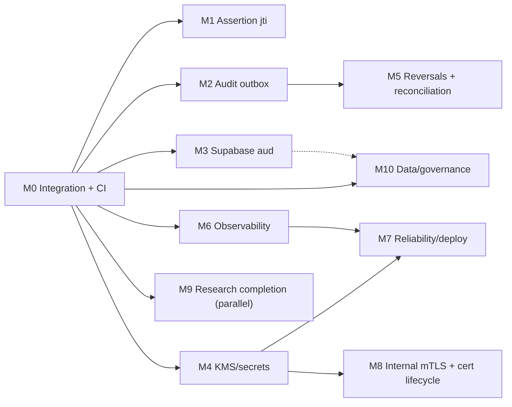

# Implementation Plan — toward research completion + production-grade technical readiness

**Derived from:** `docs/audits/00`–`09` (NFR audit, 2026-11-02).
**Re-verified:** 2026-11-02 against the full-system branch `design/spatial-fintech` (the only branch that contains the Supabase OTP work + web app). **No source code was modified to produce this plan.**
**Stance:** preserve the working research architecture (hybrid TLS, wire-verified group, per-peer policy, double-entry core, hash-chained audit, CBOM/HNDL/benchmark). The plan adds integrity/identity/ops hardening *around* that core and completes the science; it does **not** rewrite the prototype or replace the reference core.

> Nothing below is claimed "done." Statuses are either **RE-VERIFIED** (checked against code this session) or **PLANNED**. Completion of any milestone requires its acceptance criteria to pass.

---

## 0. Re-verification of critical findings (checked this session)

| Finding (audit id) | Re-verified? | Evidence (file:line) | Verdict |
|---|---|---|---|
| Replayable partner assertion, no `jti` (F1/API-005) | ✅ | `pqc-sidecar/src/sidecar/assertion.ts:9-21,57-62` & byte-identical `ledger-service/src/partner/assertion.ts` — fields `v:1`,`iat`, 30 s window, **no nonce/jti** | CONFIRMED |
| At-least-once audit for postings (F2/FIN-010/OBS-003) | ✅ | `ledger-service/src/app/audit-service.ts:6-14,29-30` — "Ledger operations are audited after the posting commits, in a separate database transaction" | CONFIRMED |
| Supabase token `aud` not verified (F3/IAM-002) | ✅ | `ledger-service/src/adapters/supabase/verifier.ts:37-40` — `jwtVerify(..., {issuer, algorithms:["ES256"]})`, **no `audience`** | CONFIRMED |
| No KMS/HSM; signing key from disk/env/ephemeral (F4/SEC-008/009) | ✅ | `ledger-service/src/compose.ts:28-37,67-72` — PEM via env/file or ephemeral; Supabase/partner secrets are plain env | CONFIRMED |
| Reversals unimplemented (FIN-006/008) | ✅ | `ledger-service/src/domain/ledger.ts:57` only `"posted" | "reversed"`; grep found **no reversal/compensating logic** | CONFIRMED |
| No metrics; `/readyz` only on security-service (OBS-005/REL-006) | ✅ | `/readyz` only at `security-service/src/http/server.ts:75`; no prom-client/OTel/`/metrics` in service source | CONFIRMED |
| **Per-peer fallback enforcement WORKS** (PQC-003/004/005) — preserve | ✅ | `pqc-sidecar/src/policy/evaluate.ts:46-82` — deny-by-default, one decision, classical-on-hybrid-required → `rejected-violation` | CONFIRMED WORKING |
| **Hybrid TLS verified from the wire WORKS** (PQC-001/002) — preserve | ✅ | `pqc-sidecar/src/wire/observer.ts`, e2e §3 (group=X25519MLKEM768, 1120 B); re-ran `test:all` 617/617 this session | CONFIRMED WORKING |
| **Structural finding (new):** the full system exists only on `design/spatial-fintech`; `main` lacks the Supabase OTP work; the audit sits on `docs/nfr-audit` (cut from `main`). | ✅ | `git log --graph --all` | CONFIRMED — see M0 |

The two headline research/migration controls the brief calls out (hybrid TLS verification, peer-specific fallback) are **already implemented and verified** — the work here is to keep them intact while closing the integrity/identity/ops gaps and completing the science.

## 0a. Preserve list (do NOT change without a dedicated migration + test)
Hybrid/classical negotiation + `*`-prefix handling; `HandshakeObserver` wire parsing; `evaluatePolicy` decision set; cert-fingerprint identity + deny-by-default; the double-entry `assertBalanced` + DB balance trigger; both hash-chained audit schemas; idempotency hashing (order-independent, `context`-excluded); the `claim-audit` + status-registry honesty guards; the benchmark validity gate + retained invalid runs; the byte-sync contract between the two `assertion.ts` files (enforced by `ledger-service/tests/http/partner.test.ts`).

---

## Milestones (small, testable, dependency-ordered)

Each milestone is independently shippable and testable. **R** = research-critical · **P** = production hardening · **S** = security-critical (gates real-banking use). Complexity S/M/L/XL.

### M0 — Integration line + CI foundation  ·  [P, prerequisite] · S–M
**Goal:** one trustworthy integration branch and an automated gate, so every later change is regression-protected.
**Addresses:** OPS-001/002/003/010, SEC-016; the structural branch finding.
**Work:** consolidate to a single integration branch (merge `design/spatial-fintech` into `main`, or adopt it as the line; bring `docs/audits` + this plan onto it); add CI running `npm run test:all`, type-checks, web `eslint`, `npm run claim-audit`, dependency scan (`npm audit`/Dependabot/Trivy) and a CycloneDX **dependency** SBOM.
**Affected files:** new `.github/workflows/ci.yml`; no source behavior change. **Interfaces:** none. **Tests:** CI must run the existing 617 tests + claim-audit; add a "red" check (introduce a restricted phrase in a fixture → CI fails).
**Acceptance:** CI green on a clean checkout; a seeded vuln/claim fails CI; one branch holds code + audit + plan; SBOM artifact produced.
**Risk to existing functionality:** **low** (additive; merge may surface web test drift — run `test:all` after merge). **Depends:** none.

### M1 — Replay-proof partner assertion  ·  [S] · S
**Goal:** a captured assertion cannot be replayed; mint/verify stay byte-synced.
**Addresses:** F1, API-005, SEC-002.
**Affected files:** `pqc-sidecar/src/sidecar/assertion.ts`, `ledger-service/src/partner/assertion.ts` (keep byte-identical), `ledger-service/src/http/routes/partner.ts`, config for cache TTL.
**Interface change:** `PeerAssertion` gains `jti: string` (random) and bumps `v: 2`; `verifyAssertion` enforces single-use within the window.
**Tests:** replay-of-same-`jti` rejected; distinct-`jti` accepted; stale window rejected; `v:1` rejected; update the byte-equality test; e2e partner scenarios still pass.
**Acceptance:** replayed assertion → 401; `partner.test.ts` + partner e2e green.
**Risk:** **medium** — touches the partner path and the two-file sync contract; mitigated by the existing exhaustive partner tests. **Depends:** M0.

### M2 — Audit atomicity via transactional outbox  ·  [S] · M
**Goal:** no committed posting without its audit event.
**Addresses:** F2, FIN-010, OBS-003.
**Affected files:** new migration (`audit_outbox` table), `ledger-service/src/app/audit-service.ts`, `src/adapters/postgres/{ledger-store,audit-store}.ts`, posting routes (`transactions.ts`, `partner.ts`), a relay worker.
**Interface:** posting writes an outbox row **in the same transaction**; a relay appends to the audit chain idempotently.
**Tests:** crash-after-commit (fault-injected) → exactly one audit event; chain still verifies; no posting without an event.
**Acceptance:** fault-injection integration test passes; both audit chains verify; no regression in existing audit tests.
**Risk:** **medium** — modifies the posting transaction; preserve the balance trigger + idempotency. **Depends:** M0 (keep M1 independent to parallelize).

### M3 — Supabase identity hardening  ·  [S] · S
**Goal:** accept only intended-audience tokens; no silent customer creation.
**Addresses:** F3, IAM-002, DATA-012.
**Affected files:** `ledger-service/src/adapters/supabase/verifier.ts`, `src/app/identity-service.ts` (`resolveSupabaseUser`), `src/config.ts` (+`SUPABASE_AUDIENCE`), `src/ports/supabase-verifier.ts`.
**Interface:** verifier enforces `audience`; provisioning requires an explicit allow/invite.
**Tests:** wrong-`aud` rejected; uninvited project user not provisioned; invited flow unchanged; existing `supabase-verifier`/`identity-supabase`/`supabase-auth` suites still pass.
**Acceptance:** the three Supabase test suites extended + green; `.env.example` documents `SUPABASE_AUDIENCE`.
**Risk:** **low–medium** — auth path, well-tested today. **Depends:** M0.

### M4 — Secrets & key management  ·  [S/P] · L
**Goal:** keys out of plaintext files; rotation; at-rest encryption.
**Addresses:** F4, SEC-007/008/009/010.
**Affected files:** `ledger-service/src/compose.ts` (`loadSigningKeyPem`), `src/identity/tokens.ts` (multi-`kid`/JWKS), config, deploy manifests; partner/sidecar HMAC secret sourcing.
**Interface:** keys sourced from a secrets manager/KMS; JWKS publishes active + draining keys.
**Tests:** rotation keeps JWKS verifying; old `kid` verifies until drained; wrong-key rejected.
**Acceptance:** rotation drill passes; no long-lived plaintext secret on disk in the target deploy.
**Risk:** **medium** — token issuance/JWKS consumed by security-service + web; stage behind a flag. **Depends:** M0 (enables M7/M8).

### M5 — Transaction reversals + reconciliation  ·  [S] · M
**Goal:** correct erroneous postings safely; detect balance drift.
**Addresses:** FIN-006/008/012.
**Affected files:** `ledger-service/src/domain/ledger.ts`, `src/app/ledger-service.ts`, posting routes, migration, a reconciliation job (`scripts/` or service).
**Interface:** authorized reversal posts compensating balanced entries + marks the original `reversed`; reconciliation re-derives balances from `postings`.
**Tests:** reversal sums to zero; double-reversal blocked; audit present; injected drift detected.
**Acceptance:** reversal + reconciliation tests pass; sum=0 invariant holds.
**Risk:** **medium** — new write path; never mutate history. **Depends:** M2 (so reversals are atomically audited).

### M6 — Observability  ·  [P] · M
**Goal:** operational visibility.
**Addresses:** OBS-005/006/008, REL-006.
**Affected files:** each service `http/server.ts`/`main.ts` (Prometheus `/metrics`, OTel tracing, `/readyz` on ledger+sidecar, `/livez` everywhere), alerting config.
**Tests:** probes return correct states; metrics scrape; trace spans sidecar→core→audit.
**Acceptance:** dashboards + alerts defined; probes integration-tested.
**Risk:** **low** (additive). **Depends:** M0.

### M7 — Reliability & deployment  ·  [P] · XL
**Goal:** remove SPOFs; recoverable operations.
**Addresses:** REL-001/002/007/008/009/010/011, OPS-007/011/014, PERF-009, SEC-011.
**Work:** containerize all four apps + IaC + CD w/ rollback; HA Postgres (replica + PITR backups); shared limiter/session store; SLOs + error budgets; DR + failover drills.
**Tests:** restore drill; failover drill; limits hold across instances; load/soak.
**Acceptance:** tested DR with RPO/RTO; failover verified; horizontal-scale correctness.
**Risk:** **medium** (ops-heavy, little code change). **Depends:** M4, M6.

### M8 — Internal transport + cert lifecycle hardening  ·  [S/MIG] · M
**Goal:** encrypt/authenticate internal hops; manage certs.
**Addresses:** SEC-001/002, PQC-012/018, ADV-004/007/008.
**Work:** mTLS (or mesh) sidecar→core + service↔service; Postgres TLS; OCSP/CRL or short-lived peer certs; OpenSSL/Node floor assertion at startup; expiry monitoring + drift + migration-coverage metric. **Preserve the external hybrid TLS design.**
**Tests:** non-TLS internal connection refused; revoked cert rejected; too-old runtime fails loudly; coverage metric computed.
**Acceptance:** all sensitive hops encrypted+authenticated; revocation enforced.
**Risk:** **medium**. **Depends:** M4.

### M9 — Research completion  ·  [R, parallelizable] · M
**Goal:** make every scientific claim independently defensible.
**Addresses:** RES-010/018, CBOM-005, PERF-007.
**Work:** **independent** human-prepared CBOM ground truth (recompute completeness/precision/recall — this currently blocks a clean H4/F-experiment claim); session-resumption benchmark arm (reported separately); a consolidated validity-threats section (internal/external/construct/conclusion); cross-machine + `--preset full` runs.
**Affected files:** `security-service/ground-truth/cbom-ground-truth.json` (+provenance), compare output; `pqc-sidecar/src/bench/*`; `docs/` writeup.
**Tests:** metrics recomputed vs independent GT; resumption arm present; validity section complete.
**Acceptance:** H4 re-reported with independent ground truth; resumption numbers; validity section merged.
**Risk:** **none to runtime** (research artifacts). **Depends:** M0. *Can run in parallel with the security track.*

### M10 — Data protection & governance  ·  [P/COND] · M
**Goal:** the organizational + data controls a regulated deployment needs.
**Addresses:** DATA-001/006/009, GOV-001/003/005/006/009, UX-007, UX-001.
**Work:** data classification + retention; Supabase cross-border/provider assessment; risk register, incident-response plan, BCP; Bengali localization (i18n); accessibility conformance (axe/jest-axe in CI + WCAG audit + mobile nav).
**Acceptance:** documents reviewed + owners assigned; i18n live; axe in CI.
**Risk:** **low**. **Depends:** M0; Supabase items relate to M3.

---

## Dependency graph

**Research-critical vs production-hardening split:**
- **Research-critical:** M9 (and preserving M0a). Everything else is production/security hardening. Only M9 blocks a clean research publication; the research *demonstration* already passes.
- **Security-gating for real-banking use:** M1, M2, M3, M4, M5, M8.
- **Production operations:** M6, M7, M10.

## Cross-cutting risks to existing functionality
- **Branch merge (M0)** may surface web test drift between `main` and `design/spatial-fintech` — run `test:all` immediately after merging; the web README is already stale (fix in a docs pass).
- **Assertion `v:2` (M1)** and **outbox (M2)** both touch the partner posting path — sequence them and lean on `partner.test.ts` + e2e §4.
- **KMS/rotation (M4)** changes JWKS consumed by security-service and web — stage behind a flag; keep the ephemeral-dev path.
- Keep the **byte-sync** and **claim-audit/status-registry** guards green throughout; they are the project's safety net.

## Measurable program-level exit criteria
- All existing guards stay green every milestone: `test:all` (currently 617/617), `claim-audit` (0 un-negated), status-registry test, e2e (50/50).
- Security track (M1–M5, M8) closes audit findings F1–F4, F10, F11 with new regression tests.
- Research track (M9) re-reports H4 against independent ground truth.
- Production track (M6, M7, M10) delivers probes+metrics, a tested DR drill, and the governance document set.

---

## Recommended first milestone: **M0 — Integration line + CI foundation**

**Why first (not a code fix):** the brief's own step 3 says *resolve technical dependencies before dependent features.* Two dependencies gate everything else:
1. **A single integration line.** Right now the complete system exists only on `design/spatial-fintech`, `main` is behind (no Supabase work), and the audit sits on a third branch (`docs/nfr-audit`). Building security fixes on top of this split risks losing or forking work. Consolidating first is cheap and removes that risk.
2. **A regression gate.** There is **no CI**. Every subsequent milestone (M1–M10) modifies security- or money-critical paths; without an automated gate running the 617 tests + `claim-audit` + the status-registry guard on every change, regressions and over-claims can slip in. M0 turns the existing excellent-but-manual test suite into an enforced gate.

M0 is **low-risk** (additive; no runtime behavior change), **fast**, and it is the precondition that makes M1–M10 safe. The headline crypto controls the brief prioritizes — hybrid TLS verification and peer-specific fallback — are already verified working, so they need protection (a gate), not reimplementation.

**Immediately after M0**, start three parallel tracks: **M1 + M3** (small, independent security P0s), **M2 → M5** (audit atomicity then reversals/reconciliation), and **M9** (research completion — independent CBOM ground truth), with **M4** feeding the later production milestones (M7/M8).

**M0 definition of done:** one integration branch holds code + `docs/audits` + this plan; `test:all` (617), type-checks, web lint, `claim-audit`, dependency scan and SBOM all run in CI and are green on a clean checkout; a deliberately seeded restricted phrase and a seeded vulnerable dependency both fail CI.
