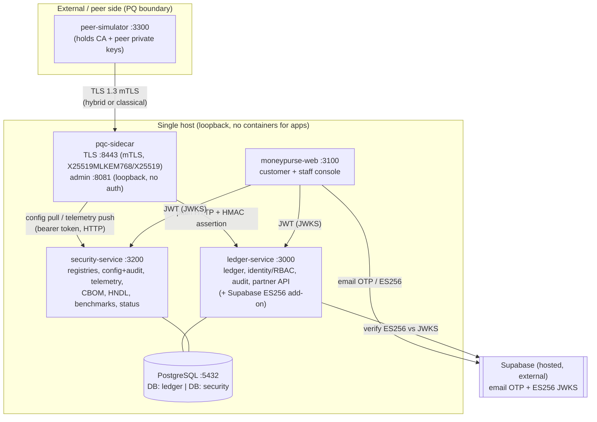
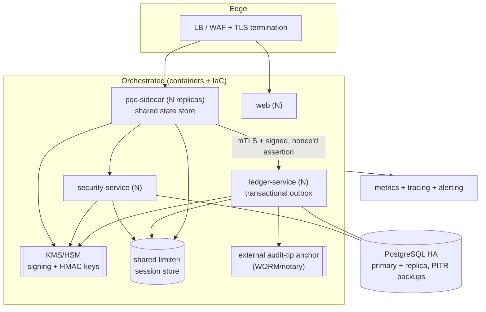

# Architectural Gaps

## AS-IS architecture

**Legend of protection:** the only hybrid-PQ-protected link is peer→sidecar (key establishment only; certificates classical). Every other link is classical: web↔services use EdDSA/ES256 JWT over (prototype) plain HTTP; sidecar→core is plain HTTP + HMAC; services↔Postgres is plain (`pg` pool, no TLS).

## Component responsibility map
| Component | Owns | Does NOT own |
|---|---|---|
| pqc-sidecar (MIG) | TLS termination, hybrid/classical negotiation, wire group verification, peer identity (cert fp), policy decision, signed assertion, telemetry, benchmarks | Business logic, persistence, authz of users |
| ledger-service (BANK ref + identity) | Accounts, double-entry postings, idempotency, identity/JWT/JWKS, RBAC, banking audit chain, partner API | TLS negotiation, crypto policy, settlement/clearing, reconciliation |
| security-service (MIG control plane) | Peer/provider/profile registries, versioned config + config audit, telemetry store, CBOM, HNDL, benchmark evidence, status registry | TLS termination, banking data |
| moneypurse-web | Presentation, session handling, SIM/LIVE/PLANNED labelling | Any authoritative enforcement (APIs enforce) |
| Supabase (external) | Customer sign-up/login + OTP email + ES256 tokens | Local RBAC/ownership/audit (stay in core) |

## Trust boundaries
1. **peer ↔ sidecar** — mutual TLS; peer identity = client-cert SHA-256; deny-by-default. *Strong.*
2. **sidecar ↔ core** — plain HTTP; trust via HMAC assertion (30 s window, method/path bound). *Weak: replayable within window; shared secret also mints; plaintext payloads on the segment.*
3. **sidecar/web ↔ security-service** — bearer token / JWT; `/internal/*` exempt from rate limit. *Moderate.*
4. **web/services ↔ Postgres** — no TLS, credentials in connection string. *Weak at deploy.*
5. **core/web ↔ Supabase** — external, cross-border; ES256 verified vs JWKS but **`aud` unchecked**; auto-provisioning. *Weak.*
6. **admin/status endpoints** — loopback only, **no authentication**. *Weak off-host.*

## External dependencies
Supabase (hosted identity + OTP email — cross-border, rate-limited, demo-grade); npm registry (lockfile-pinned, no provenance verification); Node/OpenSSL runtime (≥3.5 required for X25519MLKEM768 but **not enforced**); Docker (Postgres only).

## Unprotected / under-protected communication paths
- sidecar→core and all service→service hops: **plain HTTP** (prototype).
- service→Postgres: **no TLS**.
- Direct access to the core's port bypasses the sidecar and still serves the JWT API (`PROJECT_STATUS §10`) — **network isolation is a deployment control not provided**.
- Admin/status endpoints: unauthenticated.

## Single points of failure
Single host; single PostgreSQL server (both DBs); in-memory state in sidecar (peer registry, counters, telemetry queue, token buckets) and in-memory rate-limit/login counters in services (lockout counter is in DB); one JWT signing key (single `kid`, no rotation); one CA (no revocation). No redundancy, no failover, no backups.

## Insecure or undocumented assumptions
- OpenSSL ≥3.5 availability is assumed, not asserted (silent config rejection otherwise).
- Private-network isolation of the core and of internal hops is assumed but not enforced.
- Wall-clock equality across hosts (assertion 30 s window, `timeToApplyMs`, staleness) — safe only on one host.
- Reversals exist as a status value but no mechanism — an operator may assume corrections are possible.
- Balances are maintained incrementally with no periodic re-derivation — drift would be undetected.

## Production-target architecture (proposed)

## Proposed architecture decisions (with alternatives + migration risk)
- **ADR-A Transactional outbox for audit** (vs two-phase commit, vs accept at-least-once). *Chosen:* outbox table written in the posting's transaction + a relay to the audit chain. *Risk:* low; additive. Closes FIN-010/OBS-003.
- **ADR-B Assertion hardening: add `jti` + single-use server cache** (vs mTLS sidecar→core, vs mutual JWT). *Chosen:* `jti`+nonce first (cheap), mTLS later. *Risk:* low; backward-compatible with a version bump.
- **ADR-C KMS/HSM for signing + HMAC** (vs file keys + rotation only). *Chosen:* KMS with rotation and multiple `kid`s. *Risk:* medium; touches token issuance + JWKS publication.
- **ADR-D Shared state store (Redis/DB) for rate limits, registry cache, sessions** to enable horizontal scale. *Risk:* medium; changes limiter wiring (SEC-011, PERF-009).
- **ADR-E HA Postgres + PITR backups + DR runbook** (vs single node). *Risk:* operational, not code. Closes REL-002/008/009/010/011.
- **ADR-F Containerize all services + IaC + CI/CD** (vs bare processes). *Risk:* medium; no code change, large ops change. Closes OPS cluster.
- **ADR-G External audit-tip anchor** (periodic head-hash to WORM/notary) for OBS-003. *Risk:* low; additive.

Preserve existing working functionality and the hexagonal boundaries; none of the above requires replacing the reference core or the TLS design — they add production scaffolding around a sound prototype.
