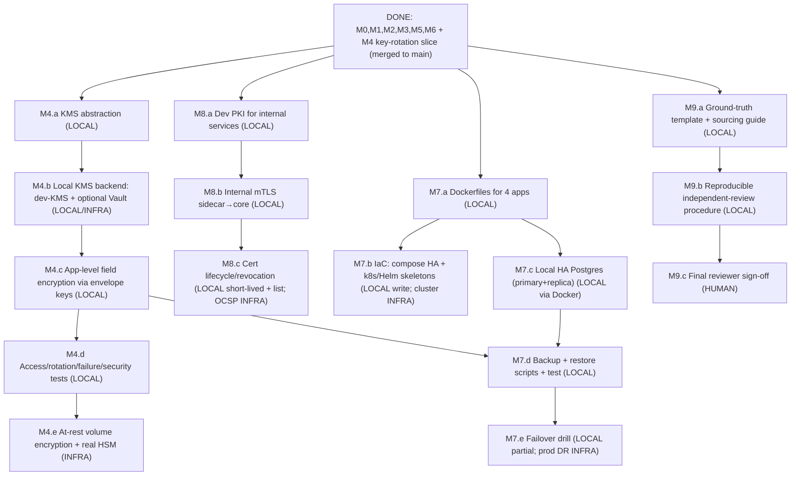

# Staged Implementation Plan — M4–M9 (KMS, HA/DR, mTLS/PKI, CBOM validation)

**Date:** 2026-11-02 · **Branch base:** `main` @ `edf71d2` (M0–M6 + M4 key-rotation slice merged).
Derived from `06_IMPLEMENTATION_ROADMAP.md` and `09_PRIORITIZED_BACKLOG.md`. Every task is classified by where it can actually be done and verified:

- **LOCAL** — fully implementable and verifiable in this repo on this machine (code + tests, Docker allowed). Produces real evidence.
- **INFRA** — needs external/production infrastructure (a real HSM, a managed KMS, a k8s cluster, encrypted storage volumes, a multi-host network). A *local dev integration* may still be LOCAL; the production control is INFRA.
- **HUMAN** — needs an independent person (not the author, not an AI): e.g. the CBOM ground-truth sign-off.

Status vocabulary per requirement: VERIFIED / PARTIAL / UNVERIFIED / BLOCKED / NOT IMPLEMENTED. No production-readiness claim is made without real verification. The PQC migration platform (sidecar + security-service) and the reference banking core (ledger-service) stay distinct throughout.

---

## Dependency graph

**Suggested order:** M4.a–d (local KMS + field encryption) → M8.a–c (PKI + internal mTLS) → M7.a–e (containers, HA Postgres, backups, failover) → M9.a–b (CBOM template + procedure), with M9.c left explicitly pending a human. M4.a–d, M8, M7.a/d and M9.a/b can all be done locally now.

---

## M4 — KMS/HSM and encryption at rest

| Task | Where | Plan | Acceptance | Evidence boundary |
|---|---|---|---|---|
| M4.a KMS abstraction | **LOCAL** | A `KeyManagementService` port: `generateDataKey()`, `wrap(dek)`, `unwrap(wrapped)`, `sign`/`getPublicKeys` for the JWT key, `rotate()`. Keeps crypto policy out of business logic (ARCH-004). | Port + a dev adapter compile and are unit-tested. | — |
| M4.b Local KMS backend | **LOCAL** (dev-KMS) / **INFRA** (prod) | A deterministic in-process **dev-KMS** adapter (AES-256-GCM key-wrapping with a master key from env/file) for tests and local run. Optionally a **Vault** dev-server adapter (`transit` engine) behind the same port, run via Docker. | dev-KMS passes wrap/unwrap round-trip + tamper-reject tests; Vault adapter (if added) verified against a local `vault server -dev` in Docker. | A real cloud KMS/HSM is **INFRA**; the port makes it a drop-in. |
| M4.c App-level field encryption | **LOCAL** | Envelope-encrypt sensitive columns (e.g. customer email/PII, the Supabase link) with a per-record DEK wrapped by the KMS; store ciphertext + wrapped DEK + key version. | Round-trip read/write; ciphertext at rest in the DB (integration test queries raw column ≠ plaintext); rotation re-wraps DEKs. | DB/volume at-rest encryption (TDE) is **INFRA**; this is application-level, which is verifiable now. |
| M4.d Access / rotation / failure / security tests | **LOCAL** | Tests: unauthorized unwrap refused, rotation keeps old data readable, KMS-down fails closed (no plaintext leak), wrapped-DEK tamper rejected. | All pass; no secret in logs (extend log-hygiene). | — |
| M4.e At-rest volume encryption + real HSM | **INFRA** | Document the deploy controls (encrypted EBS/volume, cloud KMS/HSM, envelope-key hierarchy). | — | **Not implementable here**; documented as a deploy requirement (SEC-007/009). |

**Status after M4.a–d:** SEC-008 → VERIFIED (rotation + KMS abstraction). SEC-007 app-level → PARTIAL (field encryption done; volume TDE INFRA). SEC-009 → PARTIAL (KMS abstraction + dev backend; real HSM INFRA).

## M7 — High availability and disaster recovery

| Task | Where | Plan | Acceptance | Evidence boundary |
|---|---|---|---|---|
| M7.a Dockerfiles | **LOCAL** | Multi-stage Dockerfiles for ledger, security, sidecar, web (non-root, pinned base, build+prune). | `docker build` succeeds for each; image runs `--help`/healthz. | — |
| M7.b IaC | **LOCAL** write / **INFRA** run | `docker-compose.prod.yml` (all services + HA Postgres) and k8s/Helm **skeletons**. | Compose stack starts locally; k8s manifests lint (`kubeval`/`helm template`). | A real k8s cluster + cloud LB is **INFRA**. |
| M7.c Local HA Postgres | **LOCAL** (Docker) | Compose with a primary + streaming replica. | Replica follows primary; reads from replica return committed data. | Multi-AZ/region failover is **INFRA**. |
| M7.d Backup + restore | **LOCAL** | Scripts: `pg_basebackup`/`pg_dump` backup + a restore-into-fresh-DB verifier; wire into `scripts/`. | A seeded DB is backed up, restored into a clean instance, and row counts + audit-chain verify match. | Offsite/immutable/ransomware-resistant backup is **INFRA**. |
| M7.e Failover drill | **LOCAL** partial | Promote the replica after stopping the primary; app reconnects. | Documented drill run locally with output. | True RPO/RTO under production load is **INFRA/UNVERIFIED**. |

**Status after M7 local slice:** REL-008 (backup/restore) → PARTIAL (locally verified; offsite INFRA). REL-002/007/012 (HA/failover) → PARTIAL (local primary+replica demonstrated; production HA INFRA). OPS-011 (IaC) → PARTIAL (skeletons written; cluster INFRA).

## M8 — Internal mTLS and PKI

| Task | Where | Plan | Acceptance | Evidence boundary |
|---|---|---|---|---|
| M8.a Dev PKI | **LOCAL** | Extend the existing sidecar PKI tooling to issue an internal CA + service certs (sidecar-client, ledger-server). | Certs generated with correct SAN/EKU; chain verifies. | A production PKI/HSM-rooted CA is **INFRA**. |
| M8.b Internal mTLS sidecar→core | **LOCAL** | Serve the ledger `/partner/*` over HTTPS with client-cert required; sidecar presents its client cert. Keep the HMAC assertion as a second factor. | Positive: valid client cert + assertion → 201. Negative: no/wrong cert → TLS rejected. | This encrypts the sidecar→core hop (closes the plain-HTTP boundary) with **classical** certs — explicitly reported. |
| M8.c Cert lifecycle/revocation | **LOCAL** (short-lived + revocation list) / **INFRA** (OCSP) | Short-lived service certs + a simple revocation check (fingerprint deny-list); expiry monitoring. | Revoked/expired cert rejected (negative test). | Full OCSP/CRL responder is **INFRA**. |
| M8.d Protection-level report | **LOCAL** | A table/doc stating, per hop, classical vs hybrid-PQ and what protects it. | Doc present; matches code. | — |

**Status after M8 local slice:** SEC-001/002 → PARTIAL→VERIFIED for the sidecar→core hop (mTLS locally); PQC-012 → PARTIAL (revocation via deny-list; OCSP INFRA). Every hop's protection level documented (classical certs; hybrid KE only at the external sidecar boundary).

## M9 — Independent CBOM validation

| Task | Where | Plan | Acceptance | Evidence boundary |
|---|---|---|---|---|
| M9.a Ground-truth template + sourcing guide | **LOCAL** | A documented template listing every field a reviewer must fill, and exactly which source files, configs, `package-lock` entries and runtime telemetry to inspect to build the reference inventory independently. | Template committed; sourcing guide maps each asset class to its evidence location. | — |
| M9.b Reproducible review procedure | **LOCAL** | Step-by-step procedure a reviewer runs to produce the inventory **without** reading the generator, then diff against the generated CBOM. | Procedure committed and dry-runnable; diff tooling identified/added. | — |
| M9.c Final reviewer sign-off | **HUMAN** | An independent human executes M9.b and signs the result. | — | **Cannot be fabricated**; left explicitly PENDING. RES-010 stays PARTIAL until a human signs. |

---

## What needs infrastructure (cannot be VERIFIED here)
Real HSM / cloud KMS (M4.e), at-rest volume/disk encryption (M4.e), a k8s cluster + cloud load balancer + multi-AZ (M7.b/c/e production), offsite/immutable backups (M7.d production), an OCSP/CRL responder (M8.c production).

## What needs an independent human
M9.c — the CBOM ground-truth sign-off. Everything else in M9 (template, sourcing guide, procedure, diff tooling) is LOCAL and will be delivered; only the human sign-off is pending.

## Working method (applied to every milestone)
Inspect before changing; preserve working behavior; implement only justified changes; add unit + integration + security tests; run all feasible non-destructive local tests (keeping Postgres-backed suites green); record real evidence and limitations; classify each requirement; never claim production readiness without verification; keep research experiments reproducible; keep the migration platform and the reference core distinct. Each milestone lands on its own `mN/...` branch, is verified (test:all + type-check + claim-audit), then merged to `main`, and its evidence recorded in `PROJECT_STATUS.md`.
